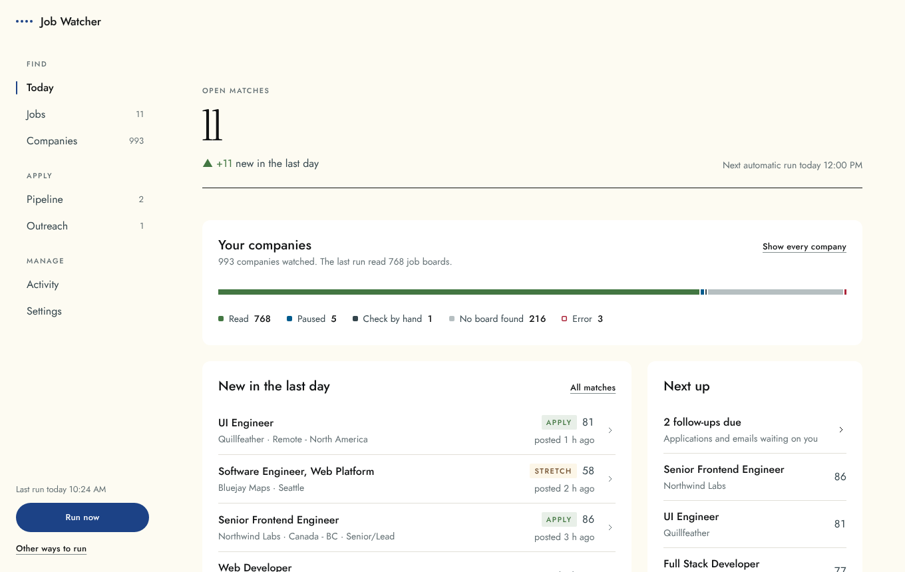
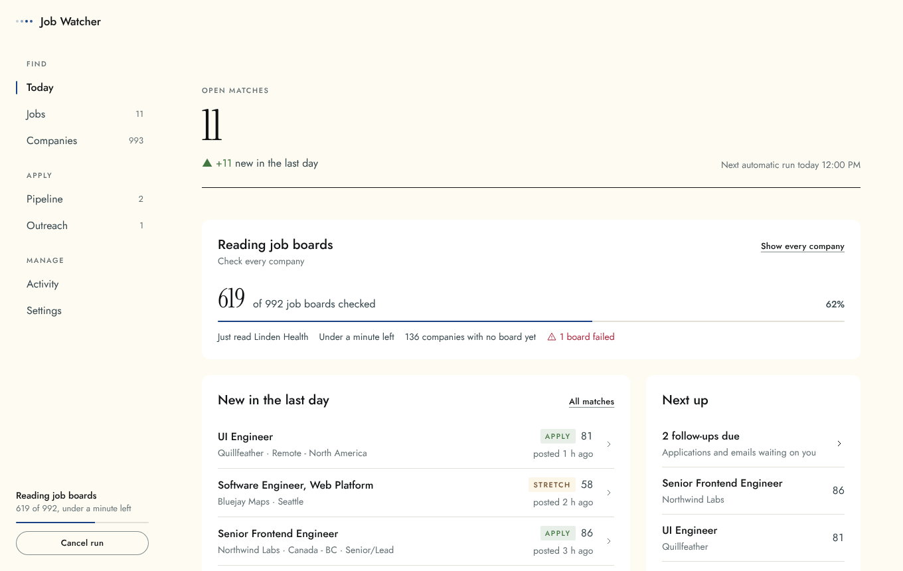
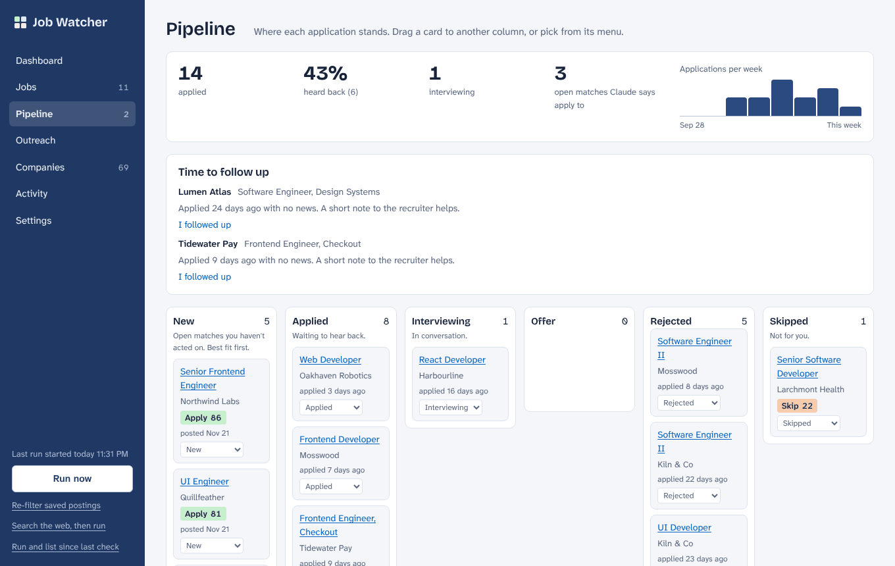
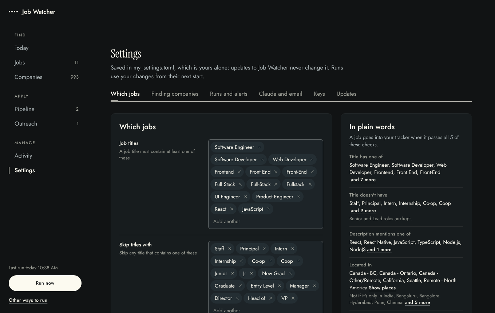

<div align="center">


# Pathfinder

by [Dixant Patel](https://github.com/PDixant)

**Find new software roles sooner, straight from companies' own job boards, and know which ones are worth your time.**

[](https://github.com/PDixant/findJobApplications/actions/workflows/tests.yml)


[](docs/design/README.md)
[](LICENSE)

[Download](#on-windows-download-it) · [What it does](#what-it-does) · [A look inside](#a-look-inside) · [Design](#designed-to-be-calm) · [Full guide](docs/GUIDE.md)



</div>

Most job sites show you a posting a day or more after it goes up, next to everyone else. Pathfinder goes straight to the source: while it's open, it checks about a thousand companies' own job boards several times a day, keeps only the roles that fit you, and helps you act while they're fresh. How soon a new role appears depends on when Pathfinder runs and how each board lists its jobs.

## What it does

- 🛰️ **Reads job boards directly.** Greenhouse, Lever, Ashby, Workday, Amazon, Oracle and more, plus companies' own careers pages.
- 🎯 **Keeps only your jobs.** Filters by title, seniority, years of experience, location, tech stack and how recently it was posted.
- 🧭 **Finds new companies.** A web search adds companies you weren't watching yet.
- 🤖 **Says if it's worth applying.** Claude compares each match with your resume and answers **Apply**, **Stretch** or **Skip**.
- 📄 **Tailors your resume.** One click rewrites your LaTeX resume for a posting, using only facts already in it.
- 💸 **Reads the fine print.** Pay range, remote or hybrid, visa sponsorship, relocation help and years of experience.
- 🤝 **Shows who you know.** Your LinkedIn connections at each company.
- 🗂️ **Tracks every application.** A pipeline board, follow-up reminders and phone alerts for new matches.

## Get started

### On Windows: download it

1. Open the **[latest release](https://github.com/PDixant/findJobApplications/releases/latest)** and download **`PathfinderSetup.exe`**. No Python or other setup needed.
2. Open it. It installs for you alone, with no admin password, and puts Pathfinder in your Start menu.
3. Open **Pathfinder**. A few quick questions (the jobs you want, where, your skills), and it starts looking.

Rather not install anything? Download **`Pathfinder-portable-win64.zip`** from the same page, unzip it anywhere and open `Pathfinder.exe`.

> [!IMPORTANT]
> Download Pathfinder only from this repository's [Releases](https://github.com/PDixant/findJobApplications/releases) page. Each release is built by GitHub Actions from the public source and lists a SHA-256 checksum for every file in `SHA256SUMS.txt`. To check your download, run this in PowerShell and compare the result with that file:
>
> ```powershell
> Get-FileHash .\PathfinderSetup.exe -Algorithm SHA256
> ```
>
> The installer isn't code-signed yet, so Windows may say it **protected your PC**. If the checksum matches, choose **More info**, then **Run anyway**.

### On a Mac or Linux, or to change the code: run it from source

**1. Get the code.** Press the green **Code** button above, then **Download ZIP** and unzip it. Or, if you use git:

```bash
git clone https://github.com/PDixant/findJobApplications.git
```

**2. Set it up.** On Windows, double-click `Install Pathfinder`; on a Mac or Linux, run `sh install.sh`. It takes a few minutes, installing Python first if your computer needs it.

**3. Open Pathfinder** from your Desktop, Start menu or Applications, or type `pathfinder` in a terminal.

> [!TIP]
> Add your keys under **Settings → Keys** to switch on the extras. All of them are optional:
>
> | Key | Turns on | Cost |
> |---|---|---|
> | [Serper](https://serper.dev) | Finding new companies with web search | 2,500 free searches |
> | [Anthropic](https://console.anthropic.com) | Fit scores, tailored resumes, email drafts | Pay per use, with a monthly cap you set |
> | [Hunter](https://hunter.io) | Finding recruiters' emails | 50 free a month |

## Everyday use

| To | Do this |
|---|---|
| **Open it** | Click **Pathfinder** on your Desktop or Start menu, or type `pathfinder` in any terminal. |
| **Check for jobs now** | Press **Run now**, low in the side bar. Its progress shows right there on every screen, and in full on **Today**, step by step: reading the job boards, then saving the postings, finding your matches and saving your tracker. While the window is open, it also checks by itself a few times a day. |
| **See what's new since last time** | **Today** splits new matches into **From your last run** and **Earlier in the last day**, so a morning run shows exactly what was posted overnight. In **Jobs**, the **Found** filter does the same, and a dot marks each job your last run found. |
| **Change what it looks for** | Open **Settings**. The **In plain words** card sums up what your settings do and marks what your unsaved changes affect. |
| **Close it** | Close the window. Nothing keeps running in the background. |

## Staying up to date

When there's a new version on GitHub, **New version ready** appears at the top right of the app. Open it to see what changed, then press **Update now**: Pathfinder downloads it, checks it, and reopens on the new version a few seconds later. The Windows app takes the new installer only from this project's Releases page, and runs it only if its SHA-256 matches the release's checksums. The portable ZIP links you to the new one.

> [!IMPORTANT]
> Updates never touch your settings, company list, jobs or keys. Those live in your own files (`my_settings.toml`, `my_companies.csv` and your data), which stay on your computer and are never shared.

## A look inside

<table>
  <tr>
    <td width="50%"></td>
    <td width="50%"></td>
  </tr>
  <tr>
    <td align="center"><b>A run</b>: one number, one line of progress, and only real problems flagged</td>
    <td align="center"><b>Jobs</b>: your fit, pay and the fine print for every match</td>
  </tr>
  <tr>
    <td width="50%"></td>
    <td width="50%"></td>
  </tr>
  <tr>
    <td align="center"><b>Pipeline</b>: where every application stands</td>
    <td align="center"><b>Settings</b>, in dark mode: summed up in plain words as you edit</td>
  </tr>
</table>

<sub>Screenshots use made-up companies.</sub>

## Designed to be calm

Pathfinder follows **[Kanso](docs/design/README.md)**, a design language for calm, crafted software created by Dixant Patel for it: warm paper, black ink and one colour of light.

- **What matters first.** Each screen opens on the one thing to know, like your open matches on **Today**.
- **Detail on request.** Your companies show as one bar. **Show every company** opens a square for each one.
- **Plain words.** Settings explains itself in short checks, and marks what your unsaved changes affect.
- **Light and dark.** It follows your computer's setting.

**[Read the design language (PDF)](docs/design/Kanso-Design-Language.pdf)** or see [how Pathfinder uses it](docs/design/README.md). Kanso is shared under the same MIT license as the code; please credit it to Dixant Patel if you build with it.

## Your data stays under your control

- 🔒 **Stored on your computer.** Your settings, jobs, tracker, resumes and contacts are files on your computer. Pathfinder has no server or account of its own.
- 🔌 **Extras talk only to the services you choose,** and each is off until you add its key. When you use an AI feature, Claude (Anthropic) receives that posting plus your resume and about-me notes. Web search receives search phrases built from your job titles and places. Hunter receives a company's name or web address. Phone alerts send each new match's company, title and link to ntfy. **[Exactly what goes where](docs/GUIDE.md#what-leaves-your-computer)**, and check each provider's privacy terms before you turn it on.
- 🔑 **Keys are kept in your computer's password store:** Windows Credential Manager, the Mac Keychain or your Linux keyring, never in a file that goes to GitHub. With no password store, Pathfinder asks before saving a key in a plain file.
- 🛡️ **Careful with what it reads.** It visits only public websites, checks every update before installing it, and treats job postings as text to read, never as instructions to follow.
- 🤝 **It's polite to job sites.** It spaces out requests and follows each site's rules.
- ✉️ **Nothing is ever sent for you.** Recruiter emails are drafts you review and send yourself.

## Something not working?

<details>
<summary><b>The <code>pathfinder</code> command isn't found</b></summary>
<br>

Close the terminal and open a new one. Still not found? Double-click **Install Pathfinder** again. (`jobwatcher`, the app's first name, still works too.)

</details>

<details>
<summary><b>Clicking Pathfinder does nothing</b></summary>
<br>

What went wrong is written to `job_watcher_errors.log` in the Pathfinder folder. Typing `pathfinder` in a terminal shows the same messages as they happen.

</details>

<details>
<summary><b>Setup stopped with "Permission denied"</b></summary>
<br>

Another program (often antivirus) was holding a file. Restart your computer, then double-click **Install Pathfinder** again, with a normal double-click rather than "Run as administrator".

</details>

<details>
<summary><b>Windows says "Windows protected your PC"</b></summary>
<br>

Pathfinder isn't code-signed yet. First make sure you downloaded it from this repository's [Releases](https://github.com/PDixant/findJobApplications/releases) page and that its checksum matches (see [Get started](#on-windows-download-it)). Then choose **More info**, then **Run anyway**. Never run a copy of Pathfinder from anywhere else.

</details>

<details>
<summary><b>I installed Python from the Microsoft Store</b></summary>
<br>

Pathfinder can't use that version. **Install Pathfinder** skips it and sets up Python from python.org instead, so just double-click it again.

</details>

## Learn more

The **[full guide](docs/GUIDE.md)** covers everything in detail:

- [Settings](docs/GUIDE.md#settings) and [finding new companies](docs/GUIDE.md#finding-new-companies)
- [Claude's help: fit scores and tailored resumes](docs/GUIDE.md#claudes-help)
- [Recruiter emails](docs/GUIDE.md#recruiter-emails), [people you know](docs/GUIDE.md#people-you-know) and [phone alerts](docs/GUIDE.md#phone-alerts)
- [All commands](docs/GUIDE.md#commands) and [which files are yours](docs/GUIDE.md#your-files)
- [The design language](docs/design/README.md) behind the interface

<details>
<summary><b>For developers</b></summary>
<br>

The app is Python (FastAPI, served only on your own computer) with a React and TypeScript interface in `ui/`, styled with the [Kanso](docs/design/README.md) tokens in `ui/src/styles.css`.

```bash
pip install -r requirements-dev.txt
python -m pytest -q tests        # uses fake job boards, no outside requests

cd ui && npm install
npm run dev                      # and in another terminal: python app.py --dev
npm run build                    # writes jobwatcher/ui_dist; commit it with your change
```

More in the [developer notes](docs/GUIDE.md#for-developers).

</details>

## License

[MIT](LICENSE): free to use, change and share. Pathfinder reads public job boards for your own job search, so please use it politely.

Made by [Dixant Patel](https://github.com/PDixant). Pathfinder was called Job Watcher at first; if you installed it under that name, it renames its shortcuts by itself the next time it opens, and your settings, jobs and keys stay where they are.
