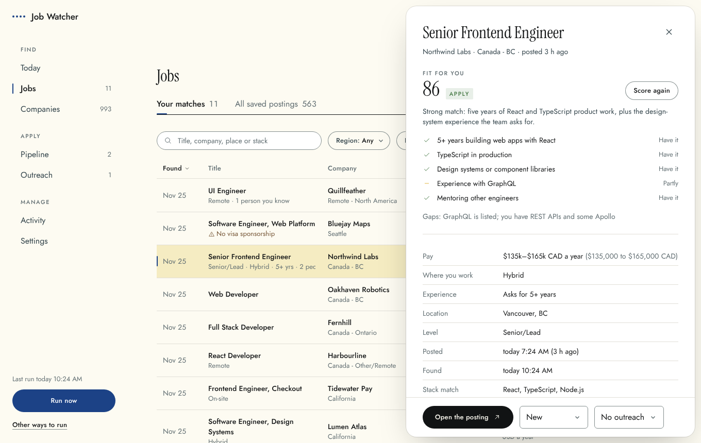
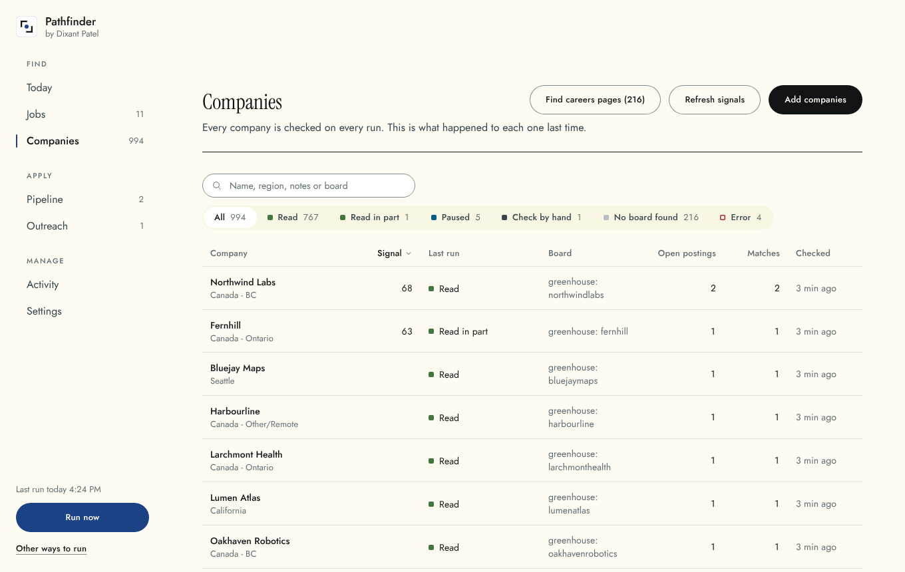

<h1 align="center">Job Watcher</h1>

<p align="center">
  <strong>Catch software jobs the hour they go up. Know which ones are worth it. Show up with a tailored resume and someone who knows you.</strong>
</p>

<p align="center">
  <a href="https://github.com/PDixant/findJobApplications/actions/workflows/tests.yml"></a>
  
  
  
</p>

<p align="center">
  
</p>

Most job sites show you a posting a day or two after it went up, next to everyone else. Job Watcher goes to the source instead: it reads about a thousand companies' own job boards several times a day, keeps only the roles that fit you, and helps you act on them while they're fresh.

## What it does

| | |
|---|---|
| 🛰️ **Reads the boards directly** | Greenhouse, Ashby, Lever, Workday, SmartRecruiters, Workable, Amazon, Oracle Recruiting, Eightfold, iCIMS and plain careers websites. Every company, every run. |
| 🎯 **Filters for you** | Title, seniority, regions, tech stack and freshness (posted in the last 24 hours, by default). Change a rule and re-filter instantly, with no new requests. |
| 🧭 **Finds companies you didn't know** | A twice-daily web search adds new companies to your list on its own. Paste any job link or import a spreadsheet to add more. |
| 🤖 **Tells you if it's worth applying** | Claude reads each new match against your resume and says **Apply**, **Stretch** or **Skip**, with what you have and what's missing. |
| 📄 **Tailors your resume** | One button rewrites your LaTeX resume for that posting, using only facts already in it, and makes the PDF. |
| 💸 **Reads the fine print** | Pay range, remote or hybrid, relocation help, "no visa sponsorship", security clearance, reposted roles and roles open for months. |
| 🤝 **Shows who you know** | Import your LinkedIn connections and every match shows the people you know at that company. |
| 📬 **Drafts recruiter emails** | Finds a recruiter and an engineering lead, and Claude drafts short, factual emails. You send them. Nothing is ever sent for you. |
| 🗂️ **Tracks your pipeline** | Drag applications from Applied to Interviewing to Offer, see your weekly pace, and get nudged when it's time to follow up. |
| 📱 **Pings your phone** | New matches arrive as phone notifications through ntfy (free, no account). |

## Quick start

1. **Get the folder.** Download this repository (green **Code** button, **Download ZIP**) or `git clone` it.
2. **Double-click `Install Job Watcher`.** It sets everything up in a private Python environment and adds a **Job Watcher** shortcut to the top of this folder, your Start menu and your Desktop, plus a `jobwatcher` command for any terminal. It needs Python 3.10 or newer from python.org and installs it for you if it isn't there (see *Python from the Microsoft Store* below).
3. **Double-click the Job Watcher shortcut** (right here in this folder, next to Install Job Watcher). A few welcome steps ask for the job titles, places and skills you want, then it runs. While it's open it also runs by itself a few times a day. Close the window and it quits completely.

On a Mac or Linux, run `sh install.sh` instead. Prefer a terminal? `pip install -r requirements-app.txt`, then `python app.py`.

## Open it with one click, or one command

Once **Install Job Watcher** has run (step 2 above), you don't need to open this folder or type `python` again:

| Do this | From where | What you see |
|---|---|---|
| **Double-click Job Watcher** | The shortcut at the top of this folder, on your Desktop, or in the Start menu | Just the app window |
| **Type `jobwatcher`** | Any terminal, in any folder. Open a *new* terminal after installing so it picks up the command | The app window, with its log in the terminal. Closing the terminal closes the app |

**Where is the .exe?** You don't need to find it: the **Job Watcher** shortcut at the top of this folder opens it. (The installer builds two in `.venv\Scripts`: `jobwatcher-app.exe`, which every Job Watcher shortcut opens, and `jobwatcher.exe`, the terminal version behind the `jobwatcher` command. Both run the same app; the shortcut starts the terminal version with its console window hidden.) Keep the folder where it is: if you move or rename it, double-click **Install Job Watcher** again so the shortcuts and the command follow.

If it's already open, clicking or typing `jobwatcher` again just brings the window to the front. Closing the window quits Job Watcher: nothing keeps running in the background unless you ask it to (see *Running in the background* below). More from the same command:

| Command | What it does |
|---|---|
| `jobwatcher` | Open the app |
| `jobwatcher --browser` | Open it in your web browser instead of its own window |
| `jobwatcher run` | A run in the terminal, with the same options as `python job_watcher.py` (for example `jobwatcher run --refilter`) |
| `jobwatcher outreach` | The same as `python outreach.py` |
| `jobwatcher folder` | Open the folder with your settings and data |

**If something doesn't open**

- **`jobwatcher` not found:** close the terminal and open a new one. Still not found? Double-click **Install Job Watcher** again.
- **Clicking does nothing:** a start without a terminal writes what went wrong to `job_watcher_errors.log` in this folder. Typing `jobwatcher` in a terminal shows the same messages as they happen.
- **Python from the Microsoft Store:** Job Watcher can't use it. The Store version keeps files it writes under `AppData` in a private copy that only it can see, so the `jobwatcher` command and the Start menu shortcut it set up were invisible to the rest of Windows, and the app could fail to open from a click. **Install Job Watcher** now skips it, installs Python from python.org instead, and rebuilds `.venv` with that. If you installed with the Store version before, just double-click **Install Job Watcher** again.

**Uninstall Job Watcher** removes the shortcuts and the command, and keeps your data.

> **Tip:** add your keys under **Settings, Keys and accounts** (all optional): Serper for finding new companies, Anthropic for Claude's help, Hunter for recruiter emails. They're kept in Windows Credential Manager, never in a file that goes to git.

## A quick tour

**Jobs.** Every match with its fit score, pay, workplace and flags. Click one for the full picture: Claude's read on your fit, your tailored resume, people you know there and the description.



**Pipeline.** Where every application stands, how many you sent each week, how often you hear back, and who's due a follow-up.


**Companies.** Every company's last result in plain words (read, paused by a rate limit, nothing readable, no board found), its board, open postings and a 0 to 100 "worth applying" score.



The screenshots use made-up companies.

## Your data stays yours

Job Watcher runs on your computer. The app's window talks to a small server on 127.0.0.1 that only answers requests carrying a code the window gets at launch, so other programs and websites can't use it.

| What | Where it goes |
|---|---|
| Your settings, company list, tracker, saved postings, resumes, about-me and LinkedIn connections | Stay in your Job Watcher folder |
| API keys, the Gmail app password and your ntfy topic | Windows Credential Manager (Keychain on a Mac) or `.env`. Masked in the app and scrubbed from every log line |
| A posting, your resume and `about_me.md` | Sent to Anthropic only when Claude scores a fit, tailors a resume or drafts an email, with a monthly cap you set |
| Search queries | Your search service (Serper, Brave or SerpApi) |
| A company's email domain | Hunter, when you look for a recruiter |
| Company, title and link of new matches | Your private ntfy topic, if you turn on phone alerts |

Everything personal is in `.gitignore`, so it never reaches GitHub. Requests to job sites are spaced out, back off when a site asks, follow `robots.txt`, and say honestly that they come from a personal job-search tool.

## Reference

Everything below is optional reading. Open a section when you need it.

<details>
<summary><strong>Commands</strong></summary>

| Command | What it does |
|---|---|
| Double-click **Install Job Watcher** | One time: Start menu and Desktop shortcuts, and the `jobwatcher` command for any terminal |
| `jobwatcher` | Open the app from any folder (or bring it forward). `--browser` opens it in your web browser |
| `jobwatcher run [options]` | A run, with the same options as `python job_watcher.py` |
| `jobwatcher outreach [options]` | The same as `python outreach.py` |
| `jobwatcher folder` | Show and open the folder with your settings and data |
| `python job_watcher.py` | One full run: search for new companies if due, read every board and careers page, update the tracker |
| `python job_watcher.py --loop` | Keep running, every `check_every_minutes` |
| `python job_watcher.py --since-last-check` | Report only postings that appeared since your last check (`--hours 72` for a fixed window) |
| `python job_watcher.py --refilter` | Re-apply your filters to saved postings and rebuild the tracker, with no requests |
| `python job_watcher.py --show-config` | Explain your settings in plain English, including the exact search queries |
| `python job_watcher.py --search` | Run the new-company web search now (`--look-back week` to search wider once) |
| `python job_watcher.py --no-search` | Skip the web search for this run |
| `python job_watcher.py --import list.xlsx` | Add the companies in spreadsheets (.xlsx or .csv) |
| `python job_watcher.py --add <link>` | Watch a company from any job posting, job board or careers page link (`--name` to name it) |
| `python job_watcher.py --find-career-pages` | Use web search to find careers pages for companies with no board found |
| `python job_watcher.py --verify` | Re-check every company, including ones marked `not_found` |
| `python job_watcher.py --refresh-metrics` | Refresh stock metrics and company scores, then exit |
| `python outreach.py` | Prepare recruiter emails for jobs marked `Email` |
| `python outreach.py --follow-ups` | Prepare one follow-up for emails marked `Sent` with no reply |
| `python outreach.py --export-drafts <folder>` | Turn a packet's `emails.json` into `.md` and `.eml` drafts |
| `python outreach.py --make-drafts <folder>` | Put a packet's emails into Gmail Drafts, resume attached |
| `python outreach.py --credits` | Hunter credits used and left this month |

</details>

<details>
<summary><strong>Files, and which ones go to git</strong></summary>

| File | What it is | In git? |
|---|---|---|
| `job_watcher.py`, `app.py`, `outreach.py`, `jobwatcher/` | The program | Yes |
| `ui/`, `jobwatcher/ui_dist/` | The app's interface source, and the built copy (so you don't need Node) | Yes |
| `Install Job Watcher.bat`, `Uninstall Job Watcher.bat`, `install.sh`, `install/`, `pyproject.toml`, `packaging/` | Setup, the `jobwatcher` command and the Windows installer build | Yes |
| `tests/`, `requirements*.txt`, `.github/`, `docs/` | Tests, dependencies, the test workflow and README pictures | Yes |
| `config.toml` | Your settings, with a note above each one. Never holds a key | Yes |
| `companies.csv` | The companies to watch; grows by itself | Yes |
| `about_me.example.md`, `resume_rules.example.md`, `.env.example` | Templates for your personal files | Yes |
| `.env` | Keys, if you keep them in a file rather than the password store | No |
| `about_me.md`, `resume.pdf`, `resume.tex`, `resume_rules.md`, `resumes/` | You, your resumes and your tailoring rules | No |
| `outreach/` | Email packets, drafts and the contacts cache | No |
| `job_tracker.xlsx`, `all_postings.csv`, `postings.db`, `job_watcher_state*.json`, `job_watcher.log`, `job_watcher.lock`, `.app_window/` | Made as it runs: your tracker, every saved posting, run history, your LinkedIn connections and the app's remembered filters | No |

</details>

<details>
<summary><strong>How a run works</strong></summary>

**Every company is checked on every run.** Each company's job board is read through its public feed, normally one request per board. For a company whose board isn't known yet, Job Watcher reads its careers page, which usually names the board, and otherwise guesses board names. Found boards are written back to `companies.csv`. Guessing for companies where nothing was found is retried once a day (`retry_board_search_hours`), so runs stay quick and job sites stay friendly.

**Two lists.** Every open posting from every board is kept in `postings.db` (and `all_postings.csv` for Excel). Only the ones that pass your filters go to your matches and `job_tracker.xlsx`. Filtering happens on your computer, so changing a rule never costs a request: **Re-filter saved postings** (or `--refilter`) re-applies it instantly.

**One run at a time.** The app, a terminal and an old scheduled task never run together; a second run says so and stops.

**Being polite.** Requests to each site are spaced out (Workable gets the most room). If a site says "too many requests", Job Watcher waits as long as it asks and leaves the site alone for the rest of the run after three refusals. Those companies show as paused and are read next run.

**Descriptions.** Workday, SmartRecruiters, Oracle and some Eightfold lists don't include descriptions, so one is fetched only for postings that could match (right title, fresh, in your regions), and only once.

**"What did I miss?"** `--since-last-check` (or **Run and list since last check**) reports only postings that went up since your last check, including ones a background run already picked up. `--hours 72` looks back a fixed window instead.

</details>

<details>
<summary><strong>Claude's help: fit scores and tailored resumes</strong></summary>

Add your Anthropic key under **Settings, Keys and accounts**. Then:

- **Fit scores.** After each run, Claude reads every new match against your resume (`resume.pdf`) and `about_me.md`. It lists the posting's hard requirements, marks each one **Have it**, **Partly** or **Missing**, and gives a verdict: **Apply** (all or nearly all met), **Stretch** (one gap you can credibly bridge) or **Skip** (a domain, language, years or work-permit requirement you can't honestly meet), plus a 0 to 100 chance of getting through a recruiter's first scan. Press **Score my fit** on any match, or **Score open matches** under Settings to catch up.
- **Tailored resumes.** Put your base LaTeX resume in the folder as `resume.tex`, and optionally your own rules as `resume_rules.md` (start from `resume_rules.example.md`). **Tailor my resume** on a match rewrites it for that posting: the most relevant bullets first, a headline backed by your bullets, the posting's tool names spelled its way, and never a tool, title, date or number you haven't given it. Numbers that would make a bullet stronger come back as a short "numbers to find" list instead of being made up. It saves `resumes/<You>_<Company>_<Title>.tex`, and the PDF too if LaTeX is installed ([MiKTeX](https://miktex.org) or [Tectonic](https://tectonic-typesetting.github.io)). Outreach attaches that PDF when you write to the company.
- **Cost control.** `monthly_limit` under `[ai]` (300 by default) is a hard stop for fit scores and resumes together, and the Settings screen shows how many you've used. Turn off `score_new_matches` to score only when you ask.

</details>

<details>
<summary><strong>Pay, work permits, workplace and other flags</strong></summary>

Read from each posting's description, on your computer:

- **Pay range**, as more places now require it (BC, Ontario, California, Washington, New York and others). A bare `$` follows where the job is: CAD for Canadian roles, USD otherwise.
- **Remote, hybrid or on-site**, from the title, locations and description.
- **Work permit limits**: no visa sponsorship, citizens only, or a security clearance.
- **Relocation help** offered (or ruled out).
- **Reposted**: the same title at the same company was posted before. **Open N days**: up for 45 days or more, which can mean hard to fill or stale.

Filter by any of them in Jobs (**Where** and **Only**).

</details>

<details>
<summary><strong>People you know (LinkedIn connections)</strong></summary>

On LinkedIn, open **Settings, Data privacy, Get a copy of your data**, and pick **Connections**. LinkedIn emails you `Connections.csv` within about 10 minutes. In Job Watcher, **Settings, People you know, Import Connections.csv**. Every match then shows how many people you know at that company, and the match's details list them with links. Company names are matched loosely ("Shopify Inc." matches "Shopify"). The list stays in `postings.db` on your computer; **Remove them** deletes it.

</details>

<details>
<summary><strong>Pipeline and follow-ups</strong></summary>

The **Pipeline** screen has a column per status (New, Applied, Interviewing, Offer, Rejected, Skipped). Drag a card or use its menu. New shows open matches you haven't acted on, best fit first. Marking a job Applied records the date.

At the top: how many you've applied to, how often you've heard back, how many are interviewing, and your applications per week for the last 8 weeks. **Time to follow up** lists applications with no news after `follow_up_after_days` and recruiter emails with no reply. **I followed up** resets the clock.

</details>

<details>
<summary><strong>Phone alerts (ntfy)</strong></summary>

1. Install the free [ntfy](https://ntfy.sh) app on your phone.
2. In Job Watcher, **Settings, Phone alerts, Make me a private topic**. It saves a long random topic name with your keys and shows it to you.
3. In the ntfy app, tap **+** and subscribe to that name. **Send a test alert** to check.

New matches then arrive on your phone with the company, title and a link. Anyone who knows the topic name can read it, which is why it's long, random and never stored in `config.toml`. Running your own ntfy server? Set `ntfy_server` under `[alerts]`.

</details>

<details>
<summary><strong>Recruiter emails</strong></summary>

Applying and then writing to a recruiter or the hiring team usually gets more attention than applying alone.

**In the app:** set Outreach to **Email** on a job, open **Outreach**, press **Find people** (one Hunter credit, kept for 60 days), tick who to write to (a recruiter and an engineering lead are picked for you; executives are flagged and left out), and press **Write drafts with Claude**. Claude writes each email from your `about_me.md`, resume and the job description, and is told never to invent experience, numbers or connections. Edit a draft, then **Open in mail app** (a ready-to-send draft with your resume attached) or **Gmail draft**. Press **I sent it** after sending; after `follow_up_after_days` it moves to **Follow-ups due**, where Claude drafts a short reply. **They replied** closes it. If you know someone at the company, Outreach says so: a referral usually beats a cold email.

**Set up once:** a free [Hunter](https://hunter.io) key (50 credits a month), and `about_me.md` filled in from `about_me.example.md` (your name, signature, what you're looking for, work authorization and a few real achievements). Put your resume in the folder as `resume.pdf`.

**Without an Anthropic key**, `python outreach.py` (or the Outreach screen) writes a packet folder under `outreach/` with everything your Claude agent needs, plus `INSTRUCTIONS.md`. Tell your agent: *Read outreach/&lt;folder&gt;/INSTRUCTIONS.md and follow it to create my draft emails.* `--make-drafts` puts the results in Gmail Drafts with your resume (needs `GMAIL_ADDRESS` and a Gmail app password), and `--export-drafts` makes `.eml` drafts for Outlook or Thunderbird.

</details>

<details>
<summary><strong>Settings (<code>config.toml</code>)</strong></summary>

Edit them in the app's **Settings** screen (it keeps the file's notes, and shows what your settings mean in plain words as you type), or in `config.toml` itself:

| Section | What it controls |
|---|---|
| `[jobs]` | `titles` to include, `skip_titles`, `must_mention` stack keywords, `max_age_hours`, and your `years_experience`: postings asking for more years than yours (plus `years_over_ok`) are left out or marked |
| `[places]` | Places to `skip`, and your regions: a name, a colour and the place names to match |
| `[search]` | The new-company web search: service, how often, sites, title words, places, query budget, and whether new companies are watched or held for review |
| `[career_sites]` | Reading companies' own careers websites |
| `[tracker]` | File names, pop-ups, since-last-check by default, `--loop` timing |
| `[outreach]` | Resume, tailored resumes folder, about-me file, contacts per company, Hunter limits, follow-up timing |
| `[schedule]` | Automatic runs while the app is open, and whether it stays in the tray after you close it (`keep_in_tray`, off by default) |
| `[ai]` | Claude: fit scores on new matches, monthly limit, model, base resume and rules files |
| `[alerts]` | The ntfy server for phone alerts |
| `[advanced]` | Request pacing, retries, Workday search terms. Commented out, showing defaults |

A deleted setting falls back to its default, a misspelled one is reported, and a typo such as a missing comma stops the run with the line number. **Keys never go in `config.toml`**: it's shared in git.

</details>

<details>
<summary><strong>The company list (<code>companies.csv</code>) and company scores</strong></summary>

About 970 companies, sorted by region and name. Add more by pasting a link in **Companies, Add companies** (or `--add`), or by importing a spreadsheet with a Company column (or `--import`). The web search adds the companies it finds at the bottom, with region `Found by search`.

| Column | Meaning |
|---|---|
| `priority`, `region`, `hubs` | Sort order, the region it's listed under, and every place it has offices |
| `board`, `slug` | `greenhouse`, `ashby`, `lever`, `workday`, `smartrecruiters`, `workable`, `auto` to detect it, or `website` / `other` for its own careers site, and the company's ID on that board |
| `careers_url`, `domain`, `ats` | Its careers page, email domain (for outreach) and a hint about its hiring system |
| `type`, `ticker`, `stage`, `last_raise`, `layoffs_12m` | For the score |
| `enabled` | `no` to stop watching without deleting the row |
| `score`, `tier`, `status`, `verified`, metrics | Filled in for you |

**Scores** run 0 to 100: A (65+), B (50 to 64), C (under 50). Public companies start at 50 and move with their 12-month share price, revenue growth, profit margin and size (from Yahoo Finance, weekly). Private companies start from their funding stage, with a bonus for a recent raise. Layoffs in the last year subtract 12 points.

**Slugs by hand:** `job-boards.greenhouse.io/acme` is greenhouse `acme`; `jobs.ashbyhq.com/Rose Rocket` is ashby `Rose Rocket`; `jobs.lever.co/acme` is lever `acme`; `apply.workable.com/acme` is workable `acme`; for Workday paste the whole careers URL. Not sure? Set board to `auto`.

</details>

<details>
<summary><strong>Finding new companies with web search</strong></summary>

Your list only covers the companies in `companies.csv`. To find the rest, Job Watcher runs the search you'd type into Google, once per job site, limited to the past day:

```
site:jobs.ashbyhq.com (intitle:"Software Engineer" OR intitle:"Software Developer") ("Toronto" OR "Vancouver" OR "Canada") -India
```

Every result link names the company's board, so new companies are added and read directly from then on, with real posting dates and full descriptions.

1. Sign up at [serper.dev](https://serper.dev) (2,500 free queries when you sign up, no card).
2. Paste the key under **Settings, Keys and accounts** (or `SERPER_API_KEY=` in `.env`).

Brave and SerpApi work too (`provider` under `[search]`). `monthly_query_limit` is a hard stop. `--search --look-back week` once is a good way to fill your list the first time.

**Which searches run.** By default each job site gets searches built from the same job titles as your job filter, your search places and your skip words. A long title list is split over a few searches per site, because Google ignores words past the 32nd. **Settings, Find new companies** lists every search exactly as it will be sent, and updates as you edit. Add your own under **Your own searches**, one per line in Google's search syntax (keep a `site:` part, since only links to job boards are used). **Edit as my own** copies a built search there so you can change it; turn off **Built searches** to run only yours. Each search reads up to `pages_per_query` result pages, so the number of queries per run is searches x pages.

</details>

<details>
<summary><strong>Careers websites and big employers' job systems</strong></summary>

For companies with their own careers site, Job Watcher reads the careers page:

1. **Is it really a job board?** Many careers pages are a Greenhouse, Lever, Ashby, Workable, SmartRecruiters or Workday board inside the company's site. Then the company is switched to that board.
2. **Is it a big employer's job system?** Amazon, Oracle Recruiting, Eightfold (used by Microsoft and others) and iCIMS load their jobs with JavaScript, so the page itself shows nothing. Job Watcher reads their job search directly instead.
3. **Otherwise it reads the job pages** linked from the careers page (or its sitemap), a few new ones per run, each only once, using the job details sites publish for Google Jobs.

It follows each site's `robots.txt` and spaces requests at least a second apart. A few sites (Google, Apple, Meta and others) still can't be read; they show **Nothing readable** with a note and need a manual look. **Find careers pages** (or `--find-career-pages`) looks up careers pages for companies with no board, one search each.

</details>

<details>
<summary><strong>Running in the background</strong></summary>

**By default nothing runs in the background.** Job Watcher runs only while its window is open, and closing the window quits it (a run that's going finishes the boards it's reading and saves first). While it's open, it also runs on its own at the times under **Settings, Automatic runs** (8:00, 12:00, 16:00 and 20:00 to start), plus once to catch up if a time passed in the last 12 hours. Turn **Run automatically** off if you'd rather only run it yourself.

**Want it checking all day without the window open?** Turn on **Settings, Automatic runs, Keep running after closing** and reopen Job Watcher. On Windows, closing the window then leaves it in the tray by the clock; right-click the icon to open it, run now, pause or quit. **Start when you sign in** (under Running in the background) then opens it quietly in the tray each time you sign in. Turning **Keep running after closing** off again also turns that off.

Have an old Windows scheduled task for `job_watcher.py`? **Settings, Running in the background** finds it and turns it off so runs don't double up. Without the app, a scheduled task or cron job running `jobwatcher run` every 30 minutes works too, as does `python job_watcher.py --loop`.

</details>

<details>
<summary><strong>The Excel tracker</strong></summary>

`job_tracker.xlsx` is rewritten after every run as a copy of your matches, with colours for region, level, status and score, a Companies tab and a legend. Once you've opened the app, edit Status, Notes and Outreach there: edits typed into the Excel file are no longer read. Never opened the app? The Excel tracker works as before, as long as it's closed when a run saves.

</details>

<details>
<summary><strong>The Windows installer (no Python needed)</strong></summary>

`packaging/` builds `JobWatcherSetup.exe`: no Python, no admin prompt, Start menu and Desktop shortcuts, and optionally the `jobwatcher` command. An installed copy keeps its data in `%APPDATA%\JobWatcher`, starting from this repository's `config.toml` and `companies.csv`, and uninstalling keeps it. To publish one, copy `packaging/release.yml` to `.github/workflows/` and push a version tag:

```
git tag v0.6.0
git push origin v0.6.0
```

GitHub builds the installer and attaches it to a Release. It isn't code-signed yet, so Windows SmartScreen shows "Windows protected your PC" the first time: **More info**, then **Run anyway**. The app checks for new releases twice a day.

</details>

<details>
<summary><strong>For developers</strong></summary>

- The code is the `jobwatcher` package: `base` (helpers, events, run lock, log redaction), `config`, `boards`, `systems` (Amazon, Oracle, Eightfold, iCIMS), `website`, `companies`, `store`, `filters`, `discovery`, `tracker`, `tracked` (`postings.db`), `runner`, `signals` (pay, permits, workplace), `ai` (fit and resumes), `referrals`, `alerts`, `outreach_app`, `scheduler`, `server` (the app's local API), `desktop` and `cli`.
- `JOBWATCHER_HOME` sets the data folder (default: this folder, or `%APPDATA%\JobWatcher` for an installed copy).
- Runs report progress as events: `jobwatcher.on_event(listener)` gets `run_started`, `board_done`, `new_match`, `run_finished` and more. Setting `jobwatcher.CANCEL` stops a run after the boards in flight.
- Tests use fake job boards, fake search results, a fake Claude and pages served from your own machine, so they make no outside requests:
  ```
  pip install -r requirements-dev.txt
  python -m pytest -q tests
  ```
- The interface is React and TypeScript in `ui/` (Node 20+):
  ```
  cd ui
  npm install
  npm run dev        # and, from the main folder: python app.py --dev
  npm run build      # writes jobwatcher/ui_dist; commit it with your change
  ```
  The server only answers on 127.0.0.1, refuses other host names, and needs the per-launch token on every `/api` call. API docs are at `/api/docs` in dev mode.

</details>

## License

MIT, see [LICENSE](LICENSE): free to use, change and share. Job Watcher reads public job boards for your own job search; use it politely (it already spaces out requests and follows robots.txt) and review every email before you send it.
