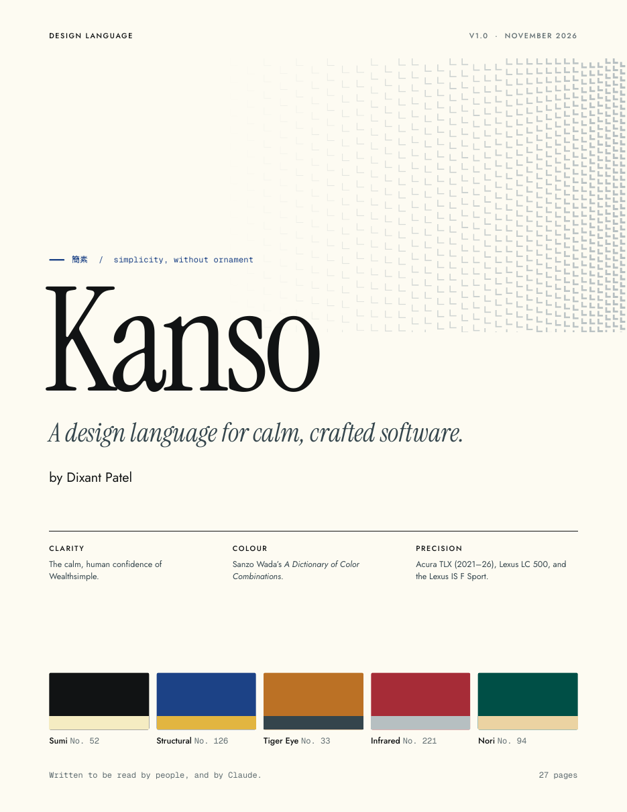
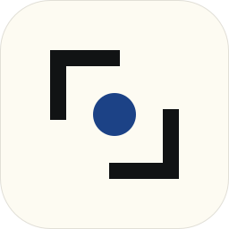

# Design

**Pathfinder's interface follows Kanso, a design language for calm, crafted software.**

**[Read the design language (PDF, 27 pages)](Kanso-Design-Language.pdf)**

Warm paper, black ink and one colour of light. Kanso sets out the feelings, ten principles and fixed values (colour, type, space, shape, motion and components) that every screen is built from, so the whole app looks like one family.

## How Pathfinder uses it

| Part | In Pathfinder |
|---|---|
| **Type** | Instrument Serif for page titles and the one number that matters on a screen. Jost for everything else. Geist Mono for search queries and the log. |
| **Colour** | Warm paper and ink, with one paint per screen: **Structural** (blue) for Today, Jobs, Companies and Activity, **Nori** (green) for Pipeline and Outreach, and **Sumi** (ink only) for Settings. |
| **Light** | The paint appears only as light: the short line beside the active screen, tab and selected row, the focus ring, and the corner brackets on a chosen person in Outreach. |
| **Space** | A long lead-in above each page, white cards on the paper with no borders, and one ink line under each page title. |
| **Detail on request** | Simple first: your companies show as one bar until you ask to see every company, and Settings sums itself up in plain words. |
| **Light and dark** | Pathfinder follows your computer's setting. Dark mode has its own values from the PDF, not an automatic flip. |

## The logo

Two of Kanso's L-brackets, the mark it uses for a chosen thing, frame one jewel of Structural light: the job you were looking for, found. It's drawn in paper, ink and one paint like every screen, so it needs no colours of its own.

- **Everywhere:** the window and taskbar icon (`jobwatcher/assets/icon.ico` and `icon.png`), the side bar, the browser tab and this repo.
- **In the app** it takes the theme's own paper and ink, so it sits quietly in dark mode, and its jewel glows while a run goes.
- **Small sizes** (16, 24 and 32 px) are drawn on whole pixels rather than scaled down, so the brackets stay crisp in the taskbar.
- **To change it,** edit [`packaging/make_icons.py`](../../packaging/make_icons.py) and run `python packaging/make_icons.py`; it writes every size and the SVG. Keep the in-app copy in `bits.tsx` (`Logo`) in step.

## Where the PDF is silent

Kanso asks that any choice it doesn't cover is listed. These are Pathfinder's:

- **Paints by area.** Pipeline and Outreach (the long game of applying) wear Nori. Settings, a document-like screen, is Sumi.
- **Light in the dark.** In dark mode the active line and focus ring use each paint's light text colour, because Structural's deep blue barely shows on near-black.
- **The lead-in** is 128 px measured from the top of the window, with the slim top bar inside it, so tables keep their room.
- **Text boxes** are 44 px high (the medium control height) rather than 56, because Settings has dozens of fields.
- **Status badges** mix their tint on white, so small badge text passes WCAG AA on the paper as well as on cards.
- **The logo** is Pathfinder's own mark, made from Kanso's L-bracket and jewel rather than taken from the PDF.
- **Company results** use status colours in an order checked for colour-blind readers: Read, Paused, Nothing readable, Check by hand, No board found. A board that failed is drawn as a ring, never by colour alone.

## In the code

Every value is a CSS custom property at the top of [`ui/src/styles.css`](../../ui/src/styles.css), named after the PDF's tokens (`--canvas`, `--surface`, `--paint`, `--light` and so on). The shared pieces (icons, the Mesh texture, the jewel dots, tabs with the sliding line) are in [`ui/src/components/bits.tsx`](../../ui/src/components/bits.tsx).

Kanso draws on Wealthsimple, Sanzo Wada's *A Dictionary of Color Combinations* and three cars, as credited on its last page. Those names are trademarks of their owners, referenced only as inspiration; neither Kanso nor Pathfinder is affiliated with or endorsed by any of them. Instrument Serif, Jost and Geist Mono are under the SIL Open Font License.
